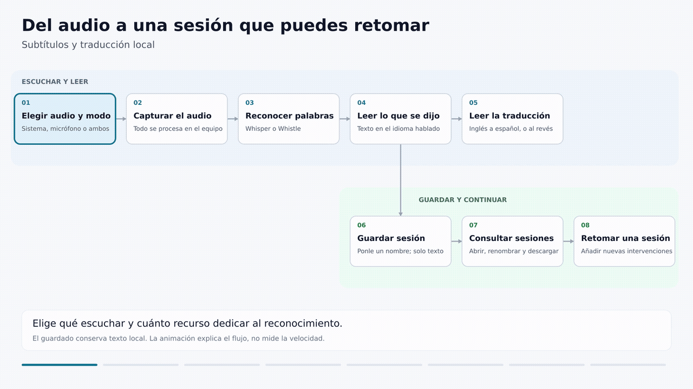

# Traductor local de audio

Subtítulos del audio del sistema o del micrófono, con original y traducción en paneles separados. La inferencia se ejecuta en el equipo. La captura está validada en Linux con PulseAudio/PipeWire. Windows y macOS incorporan adaptadores nativos experimentales, pendientes de aceptación con dispositivos reales. [Instalación y alcance por plataforma](docs/plataformas.md).



[Ver o descargar el video del flujo](docs/media/translator-flow.mp4)

## Para qué usarlo

Para seguir reuniones en inglés o español, clases y tutoriales con el texto hablado y su traducción a la vista. También puede escuchar videos del navegador o películas reproducidas en el equipo, sin una extensión específica. Con los modelos descargados, la inferencia funciona sin internet. El monitor del sistema captura el sonido de la aplicación de reunión; el micrófono permite reconocer tu propia voz. La app permite elegir sistema, micrófono o ambos. La mezcla temporal usa PulseAudio/PipeWire, conserva los dispositivos predeterminados y retira sus propios módulos al detenerse. Usa auriculares para evitar que el micrófono recoja otra vez el sonido de los altavoces.

Empieza con Whisper base para lectura progresiva. Usa auriculares y prueba antes de la reunión con el mismo equipo y fuente de audio. Revisa el original cuando la traducción resulte extraña. El programa puede equivocarse con nombres, voces superpuestas y frases incompletas.

## Qué añade sobre los motores

| Función | Usar el motor directamente | Esta app |
|---|---|---|
| Reconocer voz | Whisper y Whistle ya hacen ASR | Conecta el motor con audio del sistema o micrófono en Linux |
| Elegir tamaño y fuente | Configuración del cliente o comandos propios | Controles web para iniciar, detener y cambiar de perfil |
| Traducción local | Faster Whisper traduce hacia inglés; Whistle proporciona reconocimiento | Integra EN→ES y ES→EN con CTranslate2 en CPU |
| Seguir el texto | Depende del cliente y su tratamiento de hipótesis | Separa el original provisional de lo confirmado y conserva la última traducción |
| Revisar lo anterior | Necesita almacenamiento o interfaz adicional | Historial de 100 bloques; exportación opcional del contenido completo |
| Nombres técnicos | Hotwords y keywords ya existen en los motores | Añade edición de vocabulario, agrupación de términos y protección durante la traducción |
| Elegir consumo | El tamaño del modelo afecta al coste | Muestra medidas del perfil seleccionado y permite empezar con base |

La app integra estas funciones. No modifica los pesos de los modelos ni garantiza mayor precisión que otros clientes. Las mediciones corresponden a los ensayos descritos abajo.

La interfaz permite elegir español o inglés para sus controles. Puedes elegir siete idiomas de reconocimiento y salida de solo transcripción. La app traduce inglés → español y español → inglés; el idioma de la interfaz se elige aparte. Whistle reconoce siete idiomas, pero eso no instala automáticamente sus paquetes de traducción.

## Elegir un modo

### App web

Con el entorno preparado, ejecutar ./app.sh. Abre una página local para elegir modo y audio, iniciar, detener y aplicar cambios. La configuración empieza abierta y puede colapsarse; los controles de sesión permanecen visibles. Cada perfil muestra sus medidas orientativas de RAM y VRAM. La configuración básica contiene modo, fuente y guardado; la avanzada contiene longitud de frases, vocabulario, borradores y opciones experimentales. Aplicar y reiniciar cambia solo la sesión que creó la app.

- En vivo, base: opción inicial para texto progresivo.
- En vivo, small: otra relación entre tamaño y precisión.
- Whistle mínimo: solo transcripción en CPU, sin paquete de traducción.
- Medium por segmentos: espera pausa o cierre del segmento; mayor demora.
- Whistle CPU: disponible si su binario y pesos están preparados.

La traducción confirmada permanece visible hasta que llega otra completa. Debajo se indica su frase original, porque el reconocimiento puede avanzar antes. El borrador de traducción se activa aparte; puede cambiar y no sustituye lo confirmado.

Para una instalación nueva en Linux, con Python 3.12 y pulseaudio-utils:

    ./install.sh
    ./app.sh

El instalador prepara dependencias, traducción EN↔ES y una revisión fijada del backend WhisperLive. El archivo de licencia se conserva con sus fuentes en .runtime/whisperlive/. No levanta un servidor externo ni carga dos modelos. En la primera ejecución de Whisper, desmarcar Solo modelos descargados para permitir bajar sus pesos. Las descargas requieren conexión; la captura e inferencia posteriores son locales. Se probó la app con las dependencias existentes; no se repitió una instalación completa en otro entorno.

La interfaz controla la fuente predeterminada del sistema o micrófono. Crear acceso al menú permite abrirla después como Traductor local, sin terminal. Detener cierra la captura y mantiene la app; Cerrar app termina también el servidor local. Cerrar solo la pestaña no detiene la captura. Ctrl+C o el cierre de la terminal terminan la app y su sesión. El CLI sigue disponible para dispositivos concretos y ajustes avanzados.

### CLI

El menú ofrece base/small en vivo y medium por segmentos. Medium en vivo queda como opción experimental, porque caber en la GPU no garantiza subtítulos rápidos:

```bash
./run.sh --choose --offline --keywords vocab/tech-example.txt --save
```

El visor muestra el tamaño y dispositivo activos. Para cambiar el modelo, detener con Ctrl+C y volver a arrancar; no se cargan varios modelos a la vez.

Para ver texto progresivo, empezar con base. El visor muestra tiempo de reconocimiento y audio aproximado en cola. Una cola que crece indica que el proceso no mantiene el ritmo; esa medida no incluye toda la espera de confirmación y traducción. No aumentar el intervalo como si eso hiciera más rápido al modelo.

```bash
# Perfil ligero: Whistle CPU, si su motor y pesos ya están configurados
./run.sh --profile balanced --view web --save

# Whisper en vivo: menor tamaño, intermedio o mayor precisión
./run.sh --live --model base --save
./run.sh --live --model small --save
./run.sh --live --model medium --save

# Medium por segmentos: reduce reprocesamiento, pero espera voz/pausa o el límite
./run.sh --model medium --mode phrase --segment 8 --view web --save
```

Abrir la URL local que imprime la terminal. Sin opciones se usa Whistle balanced si sus archivos existen; en una instalación sin Whistle se usa Whisper small. `--offline` exige pesos descargados. La primera ejecución de un modelo sin ese flag puede descargarlo.

### Coste de los tres tamaños en esta laptop

Prueba del 12 de octubre de 2026: 20 clips públicos, 191,67 s de audio, 444 palabras. Misma configuración: CUDA int8_float16, beam=3, timestamps, VAD y sin contexto de texto previo.

| Modelo | WER | RAM del proceso | VRAM del proceso | Cálculo ASR para todo el audio |
|---|---:|---:|---:|---:|
| base | 8,78 % | 847 MiB | 280 MiB | 11,94 s |
| small | 9,46 % | 897 MiB | 504 MiB | 20,32 s |
| medium | 6,53 % | 1680 MiB | 1240 MiB | 38,01 s |

Son clips completos, no latencia de subtítulos en una reunión. Se excluyen traducción y navegador. Un modelo mayor puede acertar más y responder más tarde. En streaming se reprocesa audio: si medium se atrasa, probar base o el modo por segmentos. `base` y `small` no deben compararse como una mejora garantizada de precisión.

El uso diario conserva beam=1 para responder antes. `--beam-size 3` permite elegir el ajuste utilizado en la comparación.

El pipeline ligero Whistle + traducción + servidor del visor midió unos 230 MiB en otro replay. Es una prueba distinta; no mezclarla con la tabla ASR. [Medidas y configuración](docs/modelos-y-vocabulario.md).

## Nombres de aplicaciones y términos técnicos

Crear un archivo UTF-8 con un nombre por línea, o editar el ejemplo:

```text
Warp Terminal
Excalidraw
GitHub Actions
```

```bash
./run.sh --live --model small --keywords vocab/tech-example.txt --save
```

Whisper utiliza sus hotwords nativos; Whistle utiliza su opción de keywords. Son pistas, no una garantía de reconocimiento. Los nombres de varias palabras que ya fueron reconocidos se mantienen juntos al cerrar bloques y se protegen durante la traducción. No se sustituye una palabra cualquiera por el nombre que se esperaba escuchar.

En cinco frases de texto, la traducción conservó las siete apariciones de términos esperados. Antes, `GitHub Actions` se traducía y perdía su nombre. En ASR, small con seis pistas pasó de 42 a 37 errores/444 palabras en el corpus probado; varias pistas correspondían a nombres presentes en sus referencias. No se midió reconocimiento acústico de Warp Terminal o Excalidraw, ni una mejora general de conversaciones.

Usar pocos nombres que realmente se esperan. Límite: 8 KiB, 100 líneas y 160 caracteres por término. Guardar vocabulario privado en `vocab/mi-vocabulario.local.txt`, que queda fuera de Git.

## Qué reúne el proyecto

El vocabulario de ejemplo incluye tmux. La app permite activarlo y editarlo. Las variantes exactas «T mux» y «T-mux» se convierten a tmux al traducir; el original reconocido se conserva. No se corrigen «two mocks», «T max» u otros parecidos por intuición. No se ha medido aún la mejora acústica de tmux con un audio humano de referencia.

En CLI, añadir --term-aliases vocab/tech-aliases.json al vocabulario. Para recuperar un borrador cambiante separado, usar --translation-preview.

| Necesidad | Implementación |
|---|---|
| Escuchar cualquier aplicación que suene | Monitor de PulseAudio/PipeWire mediante `parec` |
| Elegir precisión y coste | Whistle o Faster Whisper, con tamaños y cuantización configurables |
| Traducir EN↔ES localmente | Paquete Argos ejecutado con CTranslate2 en CPU |
| Leer mientras se reconoce | Hipótesis provisional separada del texto confirmado |
| Conservar la última frase | Panel superior retenido hasta que llega la siguiente; historial de 100 frases |
| Guardar el contenido completo | `--save`, con original y traducción, independiente del límite del visor |
| Tratar vocabulario técnico | Pistas nativas de ASR, agrupación de términos y protección en traducción |
| Revisar sin perder la posición | Pausar lectura y desplazarse por el historial |

Los motores de reconocimiento y traducción son proyectos existentes. Whisper en vivo usa ahora el backend de WhisperLive con el modelo ya cargado; la detección de dispositivo utiliza CTranslate2 y no requiere Torch. Este wrapper conecta captura, traducción, vocabulario y presentación. El backend integrado mantuvo prácticamente el resultado de WhisperLive en el replay medido y redujo su RSS al reutilizar el modelo y evitar Torch. Frente al streaming anterior de la app bajó de 92 a 59 errores, con mayor tiempo de cálculo y unos 50 MiB más de RAM. [Comparación, configuración y cambios descartados](docs/comparacion-streaming.md).

## Sesiones guardadas

Guardar transcripción es opcional. La vista Sesiones guardadas permite abrir el registro, cambiar su nombre, descargarlo y retomar la captura en el mismo archivo. Los archivos y su configuración se guardan en .runtime/app/sessions/, con permisos privados y fuera de Git. Sin guardar no se crea una sesión persistente.

Retomar añade audio nuevo al registro. No reproduce el audio anterior ni carga una memoria semántica en el traductor. La URL local identifica la ventana de la app; cambia al reiniciarla, pero las sesiones guardadas permanecen en el equipo. La vista abre los últimos 2 MB de registros grandes; la descarga conserva el archivo completo.

## Perfil mínimo sin GPU

Whistle mínimo ejecuta reconocimiento y visor, sin cargar traducción ni detector de muletillas. En un replay público de la misma muestra se midieron 81 MiB de pico de RAM del árbol de procesos, frente a 231 MiB con traducción. Se excluyen navegador y el servidor de controles de la app. Es una medida de esa muestra, no un máximo de consumo ni una prueba de precisión con todas las voces.

Los pesos de Whistle ocupan unos 16,9 MB. El entorno Python y las dependencias ocupan espacio adicional. Se puede usar este perfil en CPU; los resultados dependen del procesador y de la duración del audio.

## Funciones opcionales y límites

- `--stream-engine legacy --utterance-pause 1.0`: separación por timestamps y baja energía. Desactivada por defecto porque los replays no demostraron una mejora consistente de reconocimiento.
- `--disfluency-model CARPETA`: anota posibles disfluencias en inglés, sin borrar el original ni limpiar la traducción. La prueba privada añadió unos 45 MiB al pipeline CPU. Los pesos evaluados son de investigación y no se incluyen en el repositorio.
- **Ventana flotante**: usa Document Picture-in-Picture si el navegador la ofrece. En el navegador integrado, pulsar el botón no produjo una ventana verificable ni un error visible. La apertura nativa sigue pendiente de comprobar en un navegador de escritorio compatible. Cerrar esa ventana devuelve el panel al visor; Ctrl+C detiene el traductor.

El programa no predice el futuro ni determina qué comentarios eran respuestas al chat. Traduce bloques de texto, sin memoria semántica entre intervenciones. El ASR puede omitir palabras o alucinar texto en silencio; la traducción puede propagar sus errores. Se conservan fallos en los informes de pruebas.

## Instalación del modo Whisper en Linux

Se ha probado Python 3.12. Comprobar que `parec` y `pactl` están disponibles. En Debian/Ubuntu los proporciona `pulseaudio-utils`.

```bash
python3.12 -m venv .venv
.venv/bin/python -m pip install -r requirements.txt
.venv/bin/python bin/install_translation.py
.venv/bin/python bin/install_streaming.py
./run.sh --cpu --model base --view web --save
```

El instalador descarga el paquete oficial EN→ES o acepta `--package-file archivo.argosmodel`. No importa Stanza ni torch. Conserva un paquete existente y registra el hash descargado. Se verificó el paquete en una carpeta temporal y su traducción real; no se repitió la instalación completa de dependencias en otro runtime.

Para NVIDIA se necesitan bibliotecas CUDA compatibles. Las versiones de esta prueba fueron cuBLAS 12.9.2.10, cuDNN 9.25.1.1 y NVRTC 12.9.86. [Requisitos oficiales de Faster Whisper](https://github.com/SYSTRAN/faster-whisper#gpu). El launcher localiza las bibliotecas del entorno; si CUDA falla, intenta CPU y lo muestra en la terminal y el visor. No atribuir medidas de CUDA a una ejecución que cayó en CPU.

Whistle requiere preparar su binario y pesos en `.runtime/whistle/`; se conserva como opción adicional. [Configuración actual de Whistle](docs/uso-whistle.md).

## Comprobar cambios

```bash
.venv/bin/python -m unittest discover -s tests -v
```

Las pruebas rápidas cubren vocabulario, protección y recuperación de marcadores, cortes de términos y rutas inseguras de archivos ZIP. No descargan modelos. GitHub Actions ejecuta las pruebas y la revisión de archivos en cada push y pull request.

La documentación conserva las medidas de los ensayos. `benchmarks/`, los audios, pesos, entornos, notas antiguas y transcripciones quedan fuera de Git. [Guía del visor](docs/visor-en-vivo.md), [disfluencias y contexto](docs/disfluencias-y-contexto.md), [pasos antes de publicar](docs/publicacion.md).

Antes de añadir archivos a Git, ejecutar:

```bash
python3 bin/check_publication.py
```

La comprobación funciona incluso antes de `git init`. Revisa candidatos y archivos ya versionados; rechaza registros, rutas personales, ciertos formatos de credenciales y archivos fuera de la lista publicable. No imprime los contenidos detectados. Ejecutarla antes del commit y del push. GitHub Actions repite la revisión después de subir los archivos; no impide una filtración previa. Es un control preventivo, no un detector universal de información personal: revisar también el diff antes de publicar.

## Componentes utilizados

Código de este wrapper: MIT, con aviso de autoría en LICENSE. Las condiciones de motores, corpus y pesos se revisan por separado. El detector experimental no se distribuye con pesos.

- [Faster Whisper](https://github.com/SYSTRAN/faster-whisper) y [CTranslate2](https://github.com/OpenNMT/CTranslate2).
- [Whistle](https://huggingface.co/Cactus-Compute/whistle), motor [Needle](https://github.com/cactus-compute/needle).
- Paquetes de [Argos Translate](https://github.com/argosopentech/argospm-index).
- VAD y hotwords ya disponibles en el backend; el VAD adicional ensayado no se adoptó para streaming.
- [Detector FDT](https://huggingface.co/stillerman/fdt-disfluency-small-29m-v2), únicamente como investigación opcional.
- Visor con Python estándar y HTML/JavaScript, sin framework de interfaz adicional.

Los componentes y modelos conservan sus propias licencias. No incluir los pesos de investigación ni otras dependencias como si fueran código propio.

## Requisitos y alcance por plataforma

Linux con PulseAudio/PipeWire, Python 3.12 y navegador moderno. Whistle funciona en CPU sin GPU. Whisper acelerado requiere una GPU NVIDIA compatible con CUDA y las bibliotecas indicadas en esta guía. Los pesos se descargan antes del uso sin conexión.

### Hardware para empezar

Estas cifras son recomendaciones de planificación a partir de las medidas del proyecto. No son mínimos certificados: todavía no se ha probado una serie de equipos de baja capacidad. La RAM libre importa más que la RAM instalada si tienes otras aplicaciones abiertas.

| Modo | RAM total aconsejada | RAM libre al iniciar | GPU |
|---|---:|---:|---|
| Whistle mínimo o ligero, Linux | 8 GB | 2 GB | No necesita GPU |
| Whisper base en vivo | 8 GB; 16 GB con videollamada o IDE | 3 GB | CPU disponible; NVIDIA de 4 GB para empezar con aceleración |
| Whisper small en vivo | 16 GB | 4 GB | NVIDIA de 4 GB aconsejada para baja latencia |
| Whisper medium por segmentos | 16 GB | 6 GB | NVIDIA de 4 GB o más; evitar medium en vivo como opción inicial |

Para la ruta CPU, empieza con base y una CPU moderna de cuatro núcleos o más. Esto no garantiza tiempo real: comprueba el retraso con tu audio antes de usarla en una reunión. En Mac se usa CPU, sin aceleración Metal. El equipo de referencia de las mediciones CUDA tiene un i5-12500H y una RTX 3050 de 4 GiB; los runners de CI verifican funcionamiento con archivo, no rapidez en reuniones.

Las tablas de consumo anteriores miden procesos concretos, no todo el equipo. La reserva propuesta deja margen para reconocimiento, traducción y navegador, pero una videollamada, otras pestañas o un IDE pueden necesitar más. Si aparece retraso, empieza por base o Whistle, cierra aplicaciones y revisa la RAM libre. Los pesos y las dependencias requieren espacio adicional en disco y conexión durante la preparación; después puedes usar modelos descargados sin internet.

Windows usa WASAPI mediante PyAudioWPatch. macOS usa CoreAudio para micrófono y AudioTee para el sistema desde macOS 14.2. Ambas rutas son experimentales: CI comprueba lógica y replay, pero la aprobación requiere dispositivos y permisos reales. [Pasos por sistema](docs/plataformas.md).

Whistle reconoce voz en siete idiomas. Whisper incluye traducción hacia inglés. WhisperLive también documenta una capa adicional de traducción a otros destinos. Nuestra beta usa un traductor compacto separado para inglés a español y español a inglés; no ofrece todavía todos esos destinos. [WhisperLive](https://github.com/collabora/WhisperLive#running-the-client) y [Whistle](https://www.cactuscompute.com/blog/whistle).

## Traducir de español a inglés

En la interfaz, elige Español como idioma original y Traducción al inglés como salida. Base y small usan Whisper en vivo; medium trabaja por segmentos; Whistle reconoce en CPU. Mínimo CPU conserva solo transcripción. Se carga únicamente el paquete de la dirección seleccionada.

Para preparar el paquete inverso en una instalación existente:

    python bin/install_translation.py --pair es_en

El instalador fija el paquete oficial Argos es_en 1.0, compatible con SentencePiece. El paquete 1.9 usa otro tokenizer y no se mezcla con este adaptador. No se incorpora Stanza ni Torch para traducir bloques.

Cuatro frases sintéticas en español produjeron traducciones legibles, conservando una negación: “No borres los archivos” → “Don't erase the files”. En CPU con dos hilos, el proceso de traducción alcanzó 172 MiB RSS y tardó 0,15–0,21 s por frase tras cargar. Excluye reconocimiento, interfaz y navegador; no es un benchmark de reconocimiento de voz española.

## Probar la ruta nativa experimental

Windows: con Python 3.12, ejecuta `py -3.12 install.py` y abre `app.cmd`. macOS 14.2+: ejecuta `python3.12 install.py` y abre `./app.sh`. El Mac necesita herramientas Swift para preparar el capturador pequeño; no se instala un controlador virtual. En ambas plataformas empieza con Whisper base. Los perfiles Whistle preparados y medidos siguen siendo de Linux.

La interfaz continúa usando el navegador predeterminado. El servidor local controla sus propios procesos y las sesiones; no requiere una cuenta ni un servicio externo. La mezcla nativa no ofrece identificación de hablantes ni cancelación de eco.
